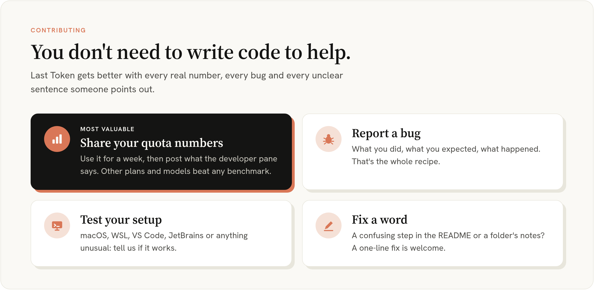
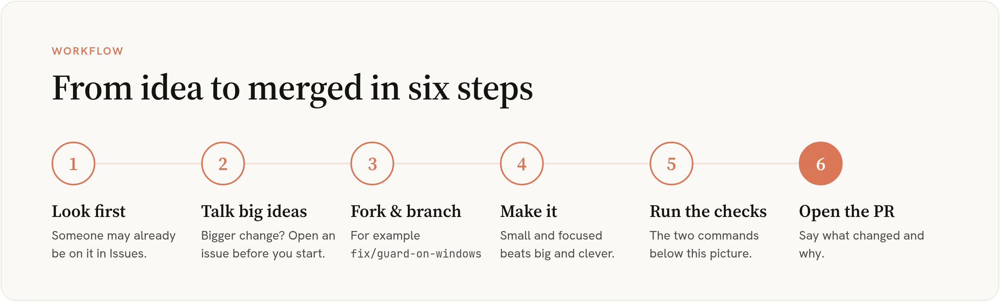
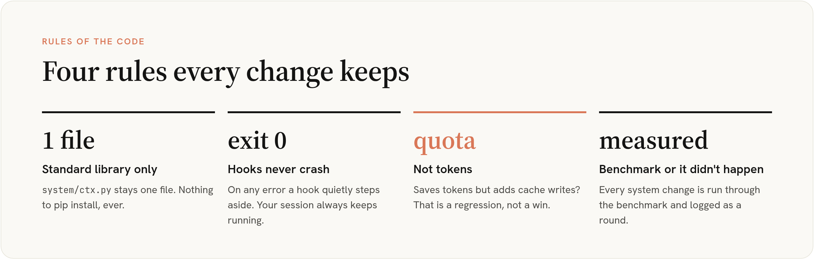

# Contributing to Last Token

<p align="center"><a href="https://github.com/ardazeybek/last-token/issues/new/choose"></a></p>

With a bug report, paste the output of:

```bash
python3 ~/.claude/last-token/ctx.py doctor
```

<p align="center"></p>

The checks (step 5):

```bash
python3 -m unittest discover system/tests      # Python tests
claude plugin test system/mod                  # mod tests (needs Claude Code)
```

<p align="center"></p>

<p align="center"><sub><a href="docs/RESEARCH.md">Why quota, not tokens</a> · <a href="bench/README.md">Run the benchmark</a> · <a href="docs/BENCHMARK.md">All rounds</a> · <a href="MAP.md">How the parts fit</a></sub></p>
