<div align="center">
  
  <h1>Last Token</h1>
  <p><strong>Make your Claude Code plan last longer: −68 % plan quota on the same work.</strong></p>
  <p>A drop-in add-on for Claude Code that spends your quota where it is cheap. Same work, same quality, nothing forgotten.</p>

  <p>
    
    
    
  </p>
  <p>
    <a href="https://github.com/ardazeybek/last-token/actions/workflows/ci.yml"></a>
    <a href="LICENSE"></a>
    
    
  </p>

  <p>
    <a href="https://github.com/ardazeybek/last-token/releases/latest/download/install-last-token.md"></a>
  </p>

  <p>
    <b>① Click the button</b> &nbsp;→&nbsp; <b>② Drag the downloaded file into Claude Code, press Enter</b> &nbsp;→&nbsp; <b>③ Done.</b><br />
    <sub>Nothing to type. Claude installs it, tunes it to your usage and keeps it updated by itself.</sub>
  </p>

  <p>
    <a href="#-install-in-30-seconds">Install</a> ·
    <a href="#-the-discovery-the-quota-formula">Quota formula</a> ·
    <a href="#-the-token-trap-why-most-token-savers-backfire">Token trap</a> ·
    <a href="#%EF%B8%8F-how-it-works">How it works</a> ·
    <a href="#-the-benchmark">Benchmark</a> ·
    <a href="CONTRIBUTING.md">Contribute</a>
  </p>
</div>

<p align="center">
  
</p>

---

## 👀 See it working

You keep working like always. Last Token works in the background and shows you what it saved.

<p align="center">
  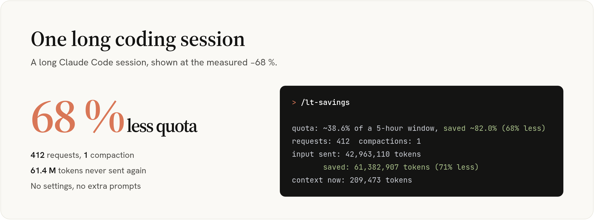
</p>

<p align="center"><sub>Type <code>/lt-savings</code> to see yours.</sub></p>

---

## 🚦 It tells you when to start fresh

<p align="center">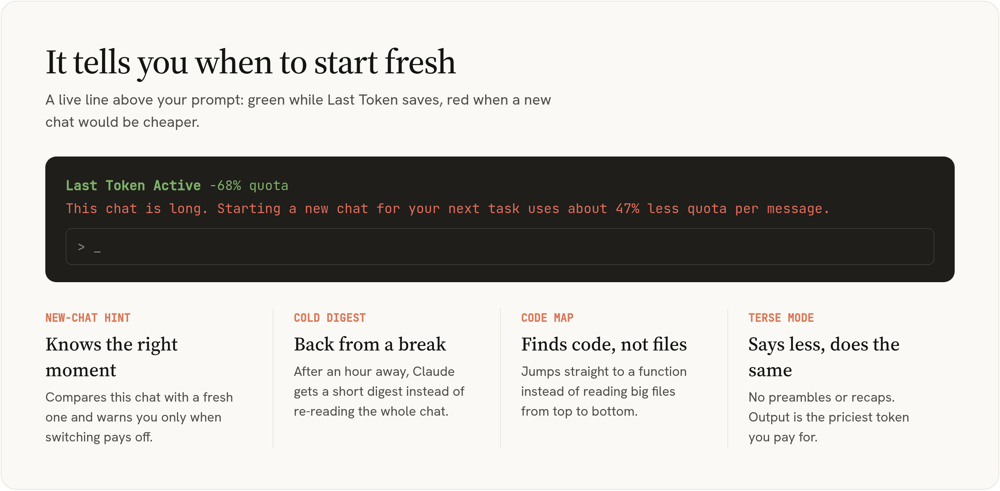</p>

## ✨ Why Last Token?

<p align="center">
  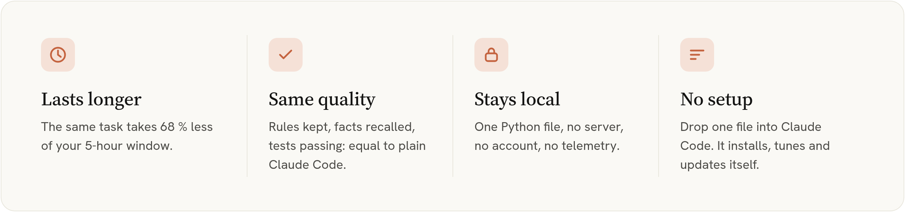
</p>

---

<p align="center"><a href="https://github.com/ardazeybek/last-token/releases/latest/download/install-last-token.md">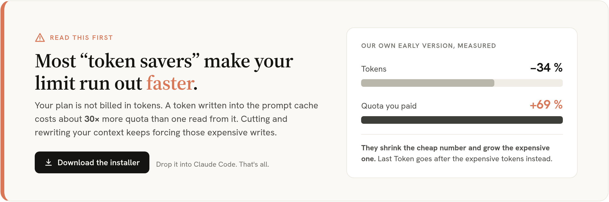</a></p>

---

## ⚡ Install in 30 seconds

<p align="center"><a href="https://github.com/ardazeybek/last-token/releases/latest/download/install-last-token.md"></a></p>

<p align="center"><b><a href="https://github.com/ardazeybek/last-token/releases/latest/download/install-last-token.md">⬇ Download the installer</a></b> (1 KB) · works in the terminal, desktop app, VS Code and JetBrains</p>

### 🔄 Updates itself

<p align="center">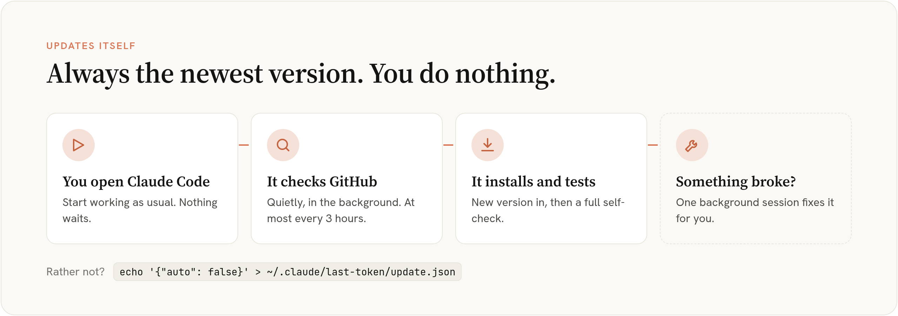</p>

<sub>Log: <code>~/.claude/last-token/update.log</code> · Update by hand: <code>python3 ~/.claude/last-token/ctx.py self-update</code></sub>

<details>
<summary><b>Rather paste a sentence?</b></summary>

```text
Install Last Token for me: clone https://github.com/ardazeybek/last-token into ~/.claude/last-token/src, then read INSTALL.md there and follow it step by step.
```
</details>

<details>
<summary><b>Prefer the terminal? One line.</b></summary>

```bash
curl -fsSL https://raw.githubusercontent.com/ardazeybek/last-token/master/get.sh | bash
```

Needs `git` and `python3` (3.9+). macOS, Linux and Windows through WSL.
</details>

<details>
<summary><b>Uninstall (one line, restores your previous settings)</b></summary>

```bash
python3 ~/.claude/last-token/ctx.py global off && python3 ~/.claude/last-token/ctx.py mod uninstall
```

A backup of your `~/.claude/settings.json` is also written on every install (`settings.json.bak-ctx-*`).
</details>

---

## 🔬 The discovery: the quota formula

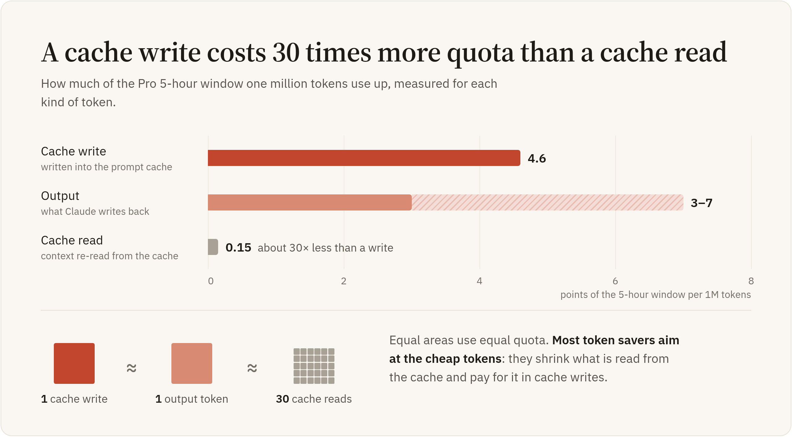

<p align="center">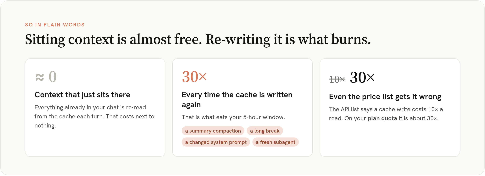</p>

<p align="center"></p>

---

## 🪤 The token trap: why most token savers backfire


### What this means for popular token tools

<p align="center">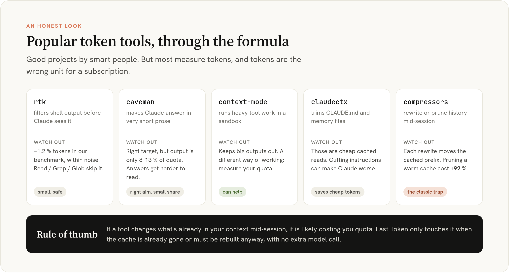</p>

<p align="center"><sub><a href="https://github.com/rtk-ai/rtk">rtk</a> · <a href="https://github.com/JuliusBrussee/caveman">caveman</a> · <a href="https://github.com/mksglu/context-mode">context-mode</a> · <a href="https://github.com/horilla/claudectx">claudectx</a></sub></p>

---

## ⚙️ How it works


<p align="center"></p>

---

## 📊 The benchmark


<p align="center"><sub>20+ rounds, every failed idea included: <a href="docs/BENCHMARK.md">BENCHMARK.md</a> · raw runs: <a href="results/">results/</a> · run it yourself: <a href="bench/README.md">bench/</a></sub></p>

---

## ❓ FAQ

<p align="center"></p>

Another question? [Ask in Discussions](https://github.com/ardazeybek/last-token/discussions).

---

## 🧰 For tinkerers

```bash
python3 ~/.claude/last-token/ctx.py doctor          # check every part
python3 ~/.claude/last-token/ctx.py audit           # what your fixed per-request context is made of
python3 ~/.claude/last-token/ctx.py tune            # re-compute per-model compaction points now
python3 ~/.claude/last-token/ctx.py recall <word>   # find an archived detail
python3 ~/.claude/last-token/ctx.py show <name>     # code map: one function's code (also where, uses, outline, map)
```

Per-project install instead of global: `./install.sh <project-dir>`. Developer quota pane:
`{"panel": true}` in `~/.claude/last-token/mod.json`, then `/lt-savings`.
Internals: [docs/DESIGN.md](docs/DESIGN.md) · [docs/RESEARCH.md](docs/RESEARCH.md) · [MAP.md](MAP.md).

---

## 🤝 Contributing

<p align="center">
  <a href="CONTRIBUTING.md">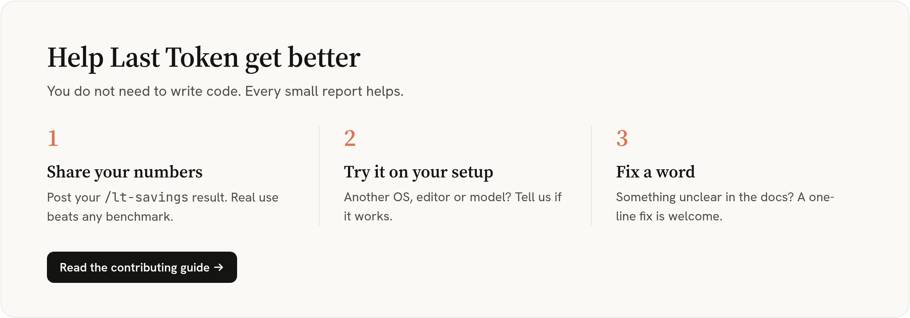</a>
</p>

<p align="center"><sub>Please follow the <a href="CODE_OF_CONDUCT.md">code of conduct</a>.</sub></p>

## 💬 Support

<p align="center">
  <a href="https://github.com/ardazeybek/last-token/issues/new/choose">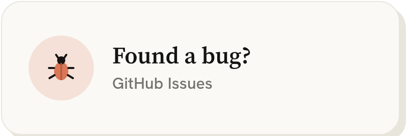</a>
  <a href="https://github.com/ardazeybek/last-token/discussions">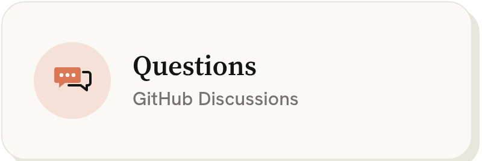</a>
  <a href="mailto:quantastudio.dev@gmail.com"></a>
</p>

## 📜 License

<p align="center">
  <a href="LICENSE"></a>
</p>

