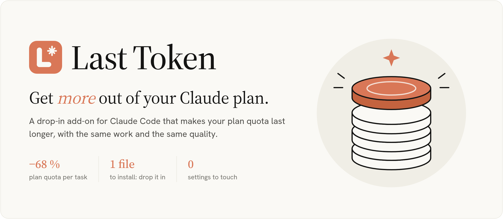
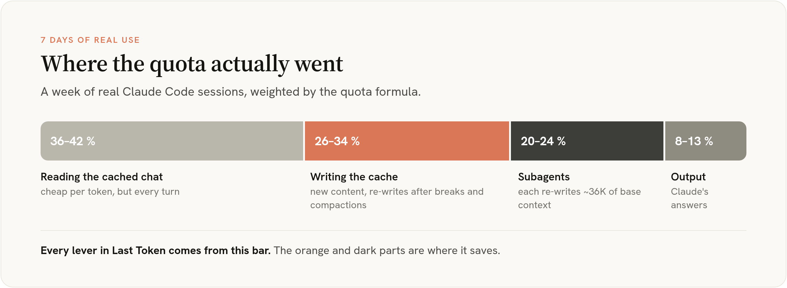
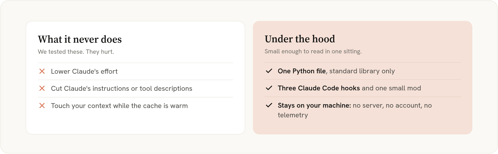
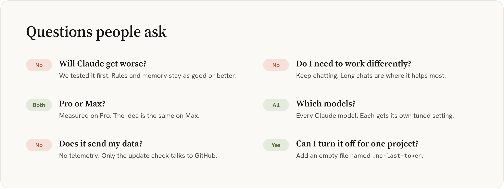
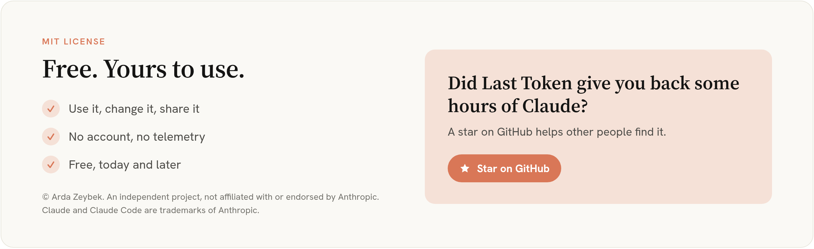

<div align="center">
  
  <h1>Last Token</h1>
  <p><strong>Make your Claude Code plan last longer: −28 % plan quota on the same work.</strong></p>
  <p>A drop-in add-on for Claude Code that spends your quota where it is cheap. Same work, same quality, nothing forgotten.</p>

  <p>
    
    
    
  </p>
  <p>
    <a href="https://github.com/ardazeybek/last-token/actions/workflows/ci.yml"></a>
    <a href="LICENSE"></a>
    
    
  </p>

  <p>
    <a href="https://github.com/ardazeybek/last-token/releases/latest/download/install-last-token.md"></a>
  </p>

  <p>
    <b>① Click the button</b> &nbsp;→&nbsp; <b>② Drag the downloaded file into Claude Code, press Enter</b> &nbsp;→&nbsp; <b>③ Done.</b><br />
    <sub>Nothing to type. Claude installs it, tunes it to your usage and keeps it updated by itself.</sub>
  </p>

  <p>
    <a href="#-install-in-30-seconds">Install</a> ·
    <a href="#-the-discovery-the-quota-formula">Quota formula</a> ·
    <a href="#-the-token-trap-why-most-token-savers-backfire">Token trap</a> ·
    <a href="#%EF%B8%8F-how-it-works">How it works</a> ·
    <a href="#-the-benchmark">Benchmark</a> ·
    <a href="CONTRIBUTING.md">Contribute</a>
  </p>
</div>

<p align="center">
  
</p>

---

## 👀 See it working

You keep working like always. Last Token works in the background and shows you what it saved.

<p align="center">
  
</p>

<p align="center"><sub>Real numbers from one long session. Type <code>/lt-savings</code> to see yours.</sub></p>

---

## ✨ Why Last Token?

<p align="center">
  
</p>

---

<p align="center"><a href="https://github.com/ardazeybek/last-token/releases/latest/download/install-last-token.md"></a></p>

---

## ⚡ Install in 30 seconds

<p align="center"><a href="https://github.com/ardazeybek/last-token/releases/latest/download/install-last-token.md"></a></p>

<p align="center"><b><a href="https://github.com/ardazeybek/last-token/releases/latest/download/install-last-token.md">⬇ Download the installer</a></b> (1 KB) · works in the terminal, desktop app, VS Code and JetBrains</p>

<details>
<summary><b>What the installer checks at the end</b></summary>

```text
  ✅ Global mode                              active in every Claude Code session
  ✅ Memory loader (SessionStart)             rules + decisions survive every compaction
  ✅ Archive (PreCompact)                     nothing is lost when context is compacted
  ✅ Big-file guard (PreToolUse)              no 50K-token whole-file reads
  ✅ Mod (no-LLM compaction, cold pruning)    compaction without a paid summarizer call
  ✅ Compaction tuned to YOUR usage           opus-5-5 ~184K, sonnet-5-5 ~200K, ...

  ★ Last Token 1.1.0 is installed. Open a NEW Claude Code session; the status line shows 'last-token ✓'.
```

</details>

### 🔄 Updates itself

<p align="center"></p>

<sub>Log: <code>~/.claude/last-token/update.log</code> · Update by hand: <code>python3 ~/.claude/last-token/ctx.py self-update</code></sub>

<details>
<summary><b>Rather paste a sentence?</b></summary>

```text
Install Last Token for me: clone https://github.com/ardazeybek/last-token into ~/.claude/last-token/src, then read INSTALL.md there and follow it step by step.
```
</details>

<details>
<summary><b>Prefer the terminal? One line.</b></summary>

```bash
curl -fsSL https://raw.githubusercontent.com/ardazeybek/last-token/master/get.sh | bash
```

Needs `git` and `python3` (3.9+). macOS, Linux and Windows through WSL.
</details>

<details>
<summary><b>Uninstall (one line, restores your previous settings)</b></summary>

```bash
python3 ~/.claude/last-token/ctx.py global off && python3 ~/.claude/last-token/ctx.py mod uninstall
```

A backup of your `~/.claude/settings.json` is also written on every install (`settings.json.bak-ctx-*`).
</details>

---

## 🔬 The discovery: the quota formula

Everyone optimizes **tokens**. But your 5-hour window doesn't count tokens. So we measured what it
*does* count: we spent one kind of token at a time and read the plan meter before and after.


<details>
<summary><b>The numbers as a table</b></summary>

| what Claude does with a token | share of your 5-hour window per 1M tokens | relative cost |
|---|---|---|
| **writes** it into the prompt cache (new context, after a compaction, after a long break) | **≈ 4.6 points** | **≈ 30×** |
| **outputs** it (its answer, code it writes) | ≈ 3–7 points | ≈ 30× |
| **reads** it from the cache (everything already in your chat) | ≈ 0.15 points | 1× |

*(1 point = 1 % of the 5-hour window, Pro plan. Method and raw numbers: [docs/RESEARCH.md](docs/RESEARCH.md).)*

</details>

<p align="center"></p>

<p align="center"></p>

<details>
<summary><b>The same as a table</b></summary>

| where the quota actually went | share |
|---|---|
| reading the cached chat | 36–42 % |
| writing the cache (new content, re-writes after breaks and compactions) | 26–34 % |
| subagents (each one re-writes ~36K of base context) | 20–24 % |
| Claude's output | 8–13 % |

</details>

---

## 🪤 The token trap: why most token savers backfire


<sub>Same story with LLM-written summaries (what Claude Code does when it auto-compacts): the summarizer call misses the cache and re-writes the whole conversation. In our benchmark that alone cost <b>+57 % quota</b>.</sub>

### What this means for popular token tools

<p align="center"></p>

<p align="center"><sub><a href="https://github.com/rtk-ai/rtk">rtk</a> · <a href="https://github.com/JuliusBrussee/caveman">caveman</a> · <a href="https://github.com/mksglu/context-mode">context-mode</a> · <a href="https://github.com/horilla/claudectx">claudectx</a></sub></p>

<details>
<summary><b>The full comparison as a table</b></summary>

| project | what it does | what it saves, by the formula | watch out |
|---|---|---|---|
| [rtk](https://github.com/rtk-ai/rtk) | filters shell command output before Claude sees it | new context gets written to the cache once, so smaller outputs do cut cache *writes* a bit | in our 32-step benchmark: **−1.2 % tokens, within noise**. Claude's Read / Grep / Glob tools don't go through it |
| [caveman](https://github.com/JuliusBrussee/caveman) | makes Claude answer in very short “caveman” prose | output **is** an expensive token, so this one is aimed at the right place | output is only ~8–13 % of real quota; you pay with harder-to-read answers |
| [context-mode](https://github.com/mksglu/context-mode) | runs heavy tool work in a sandbox, returns only the result | keeps big outputs from ever being written | a different way of working; measure your quota, not its token report |
| [claudectx](https://github.com/horilla/claudectx) & CLAUDE.md trimmers | shrink CLAUDE.md / memory files loaded every request | those files are cached after the first request: you mostly save **cheap reads** | cutting instructions can make Claude worse. We tried it and removed it |
| “compress / summarize the context” tools | rewrite or prune the history mid-session to cut tokens | every rewrite **moves the cached prefix**, so the next request re-writes the cache | the classic trap: in our stress test, pruning while the cache was warm cost **+92 % quota** |

</details>

> Last Token works alongside these tools. If you use one, compare your **5-hour % meter**, not its token report.

---

## ⚙️ How it works


<details>
<summary><b>Each lever in plain words</b></summary>

| | lever | the plain-words version |
|---|---|---|
| 01 | **Compaction at the right size, per model** | Too early = endless cache re-writes. Too late = a huge expensive one. Last Token reads *your own* transcripts and computes the sweet spot for each model (e.g. Opus ≈ 184K) with a formula, and re-tunes it every day. |
| 02 | **No-LLM compaction** | When it's time to compact, Claude Code normally asks the model to write a summary: a big, uncached, paid call. Last Token builds a precise digest itself (your words verbatim, the task list, the files, the latest steps). Zero model calls. |
| 03 | **Memory that survives** | Your rules (“never use magic numbers”), decisions (“the DB is Postgres”) and notes go to small files on disk and are loaded into every session and after every compaction. **100 % recall** in every benchmark run. |
| 04 | **Cold-cache pruning** | Come back after a break and the cache has expired: the next message re-writes everything *anyway*. Exactly then, and only then, old giant tool outputs are swapped for one-line stubs. Same stubs forever after, so the cache stays stable. |
| 05 | **Cheap look-ups** | Search/explore subagents only read and grep. They now run on Haiku: about 5× cheaper for the same answer. Your real work stays on your model. |
| 06 | **Big-file guard** | A whole read of a huge file is stopped and Claude is told to grep and read only the part it needs. |

</details>

<p align="center"></p>

---

## 📊 The benchmark


<details>
<summary><b>Exact numbers and what is tested</b></summary>

A reproducible 32-step coding task in a fresh repo. Claude is given **10 house rules** early and
**5 facts** only in chat, then has to keep following and using them through compaction after
compaction, while integration tests check the code. Scored on **plan quota**, not tokens.

| run | plan quota | rules kept | late rules | chat facts recalled | tests |
|---|---|---|---|---|---|
| plain Claude Code | 4.99 % | 98 % | 94 % | 100 % | ok |
| LLM-summary compaction | 7.84 % (**+57 %**) | 97 % | 94 % | 100 % | ok |
| **Last Token 1.0** | **3.60 % (−28 %)** | **98 %** | **95 %** | **100 %** | **ok** |

</details>

20+ rounds, every failed idea included, in [docs/BENCHMARK.md](docs/BENCHMARK.md). Raw scored runs in
[`results/`](results/). Run it yourself: [bench/README.md](bench/README.md).

---

## ❓ FAQ

<p align="center"></p>

<details>
<summary><b>The same answers in text, plus one more</b></summary>

**Will Claude get worse?** No. That was the first thing we tested and the reason several “savings”
were thrown out. Rule-following and recall are equal or better in every shipped round.

**Do I need to change how I work?** No. Keep chatting. You never have to start a new chat
“to save tokens” again: long sessions are exactly where it helps most.

**Pro or Max?** Both. Measured on Pro; the formula is about how the window is counted, which is the same idea on Max.

**Which models?** All Claude models in Claude Code. Each one gets its own tuned compaction point.

**Does it send my data anywhere?** No telemetry. The only network call is the update check to GitHub, and you can turn it off.

**Where do my notes live?** `~/.claude/last-token/store/<folder>/.ctx/`: plain Markdown files you can read.

**How do I turn it off for one project?** Create an empty file named `.no-last-token` in it.
</details>

Another question? [Ask in Discussions](https://github.com/ardazeybek/last-token/discussions).

---

## 🧰 For tinkerers

```bash
python3 ~/.claude/last-token/ctx.py doctor          # check every part
python3 ~/.claude/last-token/ctx.py audit           # what your fixed per-request context is made of
python3 ~/.claude/last-token/ctx.py tune            # re-compute per-model compaction points now
python3 ~/.claude/last-token/ctx.py recall <word>   # find an archived detail
```

Per-project install instead of global: `./install.sh <project-dir>`. Developer quota pane:
`{"panel": true}` in `~/.claude/last-token/mod.json`, then `/lt-savings`.
Internals: [docs/DESIGN.md](docs/DESIGN.md) · [docs/RESEARCH.md](docs/RESEARCH.md) · [MAP.md](MAP.md).

---

## 🤝 Contributing

<p align="center">
  <a href="CONTRIBUTING.md"></a>
</p>

<p align="center"><sub>Please follow the <a href="CODE_OF_CONDUCT.md">code of conduct</a>.</sub></p>

## 💬 Support

<p align="center">
  <a href="https://github.com/ardazeybek/last-token/issues/new/choose"></a>
  <a href="https://github.com/ardazeybek/last-token/discussions"></a>
  <a href="mailto:quantastudio.dev@gmail.com"></a>
</p>

<p align="center"><sub>Security problem? Please email privately, see <a href="SECURITY.md">SECURITY.md</a>.</sub></p>

## 📜 License

<p align="center">
  <a href="LICENSE"></a>
</p>

