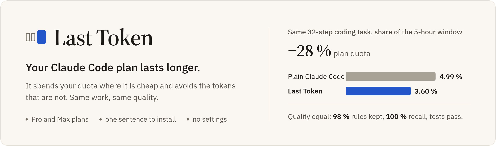
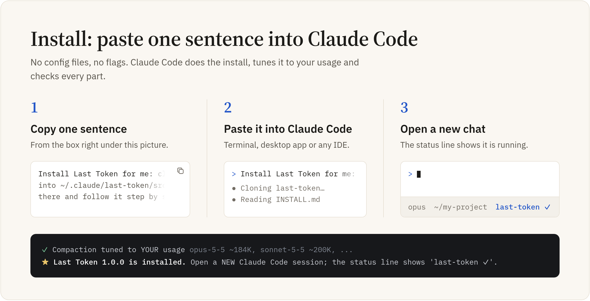
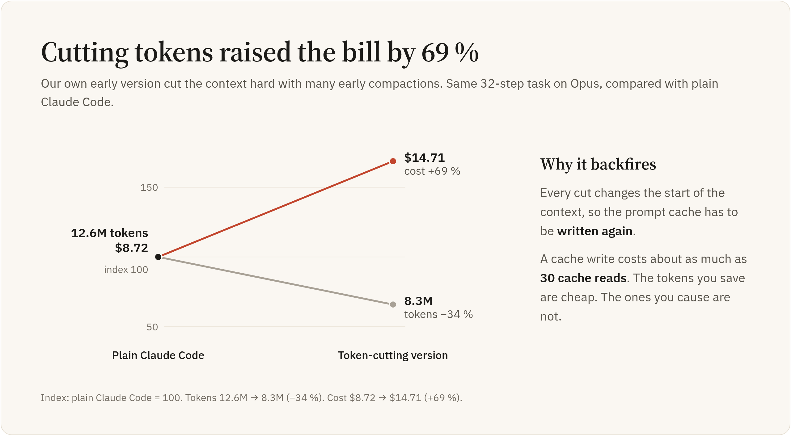
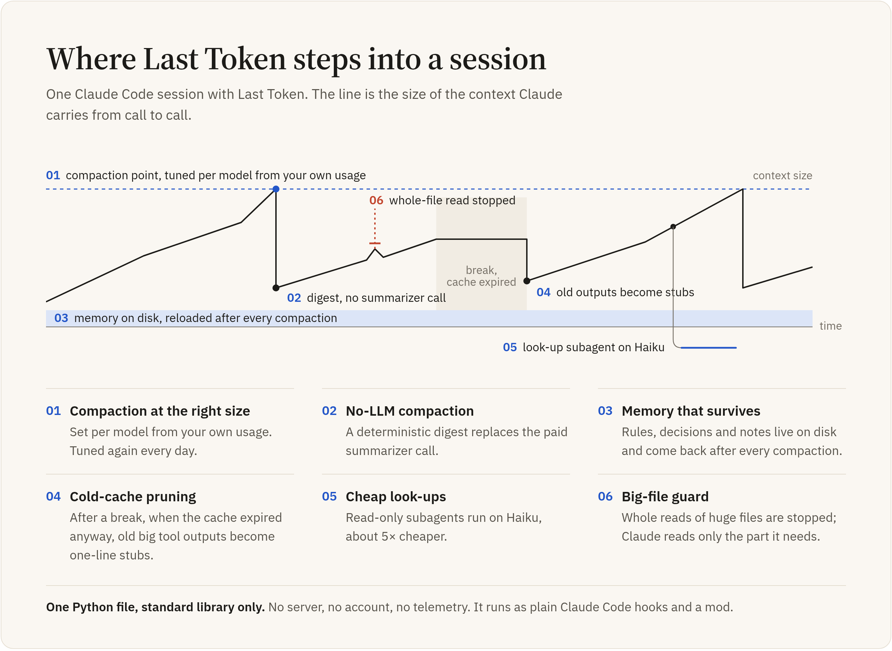
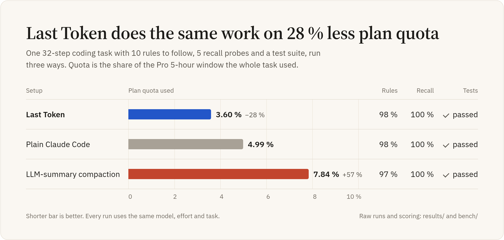

<div align="center">




# Your Claude Code limit runs out too fast. Here is why, and the fix.

**Last Token makes your Claude Pro / Max plan last longer: −28 % plan quota on the same work, with nothing forgotten.**<br>
One sentence to install. Zero settings to touch. Then you never think about it again.

[**Install in 30 seconds**](#-install-in-30-seconds) · [The quota formula](#-the-discovery-the-quota-formula) · [The token trap](#-the-token-trap-why-most-token-savers-backfire) · [Benchmark](#-the-benchmark)


</div>

---

> [!WARNING]
> ## Most “token savers” make your limit run out FASTER.
> Your plan is **not** billed in tokens. A token that Claude writes into its prompt cache costs
> **about 30 times** more of your quota than a token it reads from it. Tools that cut, compress or
> rewrite your context to “save 90 % of tokens” keep forcing those expensive cache writes.
> **They shrink the cheap number and grow the expensive one.** We measured it: our own early
> token-cutting version used **34 % fewer tokens and cost 69 % more.**
>
> Last Token is built on the real formula, so it attacks the expensive tokens instead.
> Want it? **Copy the sentence below into Claude Code. That's the whole install.**

---

## ⚡ Install in 30 seconds



**Paste this into Claude Code** (terminal, desktop app, VS Code, JetBrains, any of them):

```text
Install Last Token for me: clone https://github.com/ardazeybek/last-token into ~/.claude/last-token/src, then read INSTALL.md there and follow it step by step.
```

Claude downloads it, installs it for **every** Claude Code session, **tunes it to your own
usage** (your models, your typical session size), checks every part and ends with:

```text
  ✅ Global mode                              active in every Claude Code session
  ✅ Memory loader (SessionStart)             rules + decisions survive every compaction
  ✅ Archive (PreCompact)                     nothing is lost when context is compacted
  ✅ Big-file guard (PreToolUse)              no 50K-token whole-file reads
  ✅ Mod (no-LLM compaction, cold pruning)    compaction without a paid summarizer call
  ✅ Compaction tuned to YOUR usage           opus-5-5 ~184K, sonnet-5-5 ~200K, ...

  ★ Last Token 1.0.0 is installed. Open a NEW Claude Code session; the status line shows 'last-token ✓'.
```

Open a new chat. You'll see **`last-token ✓`** at the bottom. That's it: it now works on its own, in every project.

<details>
<summary><b>Prefer the terminal? One line.</b></summary>

```bash
curl -fsSL https://raw.githubusercontent.com/ardazeybek/last-token/main/get.sh | bash
```

Needs `git` and `python3` (3.9+). macOS, Linux and Windows through WSL.
</details>

<details>
<summary><b>Uninstall (one line, restores your previous settings)</b></summary>

```bash
python3 ~/.claude/last-token/ctx.py global off && python3 ~/.claude/last-token/ctx.py mod uninstall
```

A backup of your `~/.claude/settings.json` is also written on every install (`settings.json.bak-ctx-*`).
</details>

---

## 🔬 The discovery: the quota formula

Everyone optimizes **tokens**. But your 5-hour window doesn't count tokens. So we measured what it
*does* count: we spent one kind of token at a time and read the plan meter before and after.


| what Claude does with a token | share of your 5-hour window per 1M tokens | relative cost |
|---|---|---|
| **writes** it into the prompt cache (new context, after a compaction, after a long break) | **≈ 4.6 points** | **≈ 30×** |
| **outputs** it (its answer, code it writes) | ≈ 3–7 points | ≈ 30× |
| **reads** it from the cache (everything already in your chat) | ≈ 0.15 points | 1× |

*(1 point = 1 % of the 5-hour window, Pro plan. Method and raw numbers: [docs/RESEARCH.md](docs/RESEARCH.md).)*

**So in plain words:**

- Context that **just sits there** in your chat is almost free. Re-reading it costs ~nothing.
- What burns your limit is every time the cache has to be **written again**: a compaction with a
  summary, a long coffee break (the cache expires), a changed system prompt, a subagent that
  starts from zero.
- Even the API price list gets this wrong for subscriptions: it says cache writes are 10× reads.
  For your **plan quota** it is about **30×**.

Then we looked at **7 days of real use**, weighted by this formula:

| where the quota actually went | share |
|---|---|
| reading the cached chat | 36–42 % |
| writing the cache (new content, re-writes after breaks and compactions) | 26–34 % |
| subagents (each one re-writes ~36K of base context) | 20–24 % |
| Claude's output | 8–13 % |

Every lever in Last Token comes from this table.

---

## 🪤 The token trap: why most token savers backfire



This is **our own** mistake, measured. An early version of Last Token compacted the context early
and often. The token counter looked amazing: **−34 %**. The bill: **+69 %**. Every compaction
threw away the cheap cached context and paid to write a new one.

Same story with **LLM-written summaries** (what Claude Code does when it auto-compacts): the
summarizer call misses the cache and re-writes the whole conversation. In our benchmark that
alone made the run cost **+57 % quota**.

### What this means for popular token tools

They are good projects made by smart people, and some of them are useful. But almost all of them
measure **tokens**, and tokens are the wrong unit for a subscription. Here is an honest look,
through the formula:

| project | what it does | what it saves, by the formula | watch out |
|---|---|---|---|
| [rtk](https://github.com/rtk-ai/rtk) | filters shell command output before Claude sees it | new context gets written to the cache once, so smaller outputs do cut cache *writes* a bit | in our 32-step benchmark: **−1.2 % tokens, within noise**. Claude's Read / Grep / Glob tools don't go through it |
| [caveman](https://github.com/JuliusBrussee/caveman) | makes Claude answer in very short “caveman” prose | output **is** an expensive token, so this one is aimed at the right place | output is only ~8–13 % of real quota; you pay with harder-to-read answers |
| [context-mode](https://github.com/mksglu/context-mode) | runs heavy tool work in a sandbox, returns only the result | keeps big outputs from ever being written | a different way of working; measure your quota, not its token report |
| [claudectx](https://github.com/horilla/claudectx) & CLAUDE.md trimmers | shrink CLAUDE.md / memory files loaded every request | those files are cached after the first request: you mostly save **cheap reads** | cutting instructions can make Claude worse. We tried it and removed it |
| “compress / summarize the context” tools | rewrite or prune the history mid-session to cut tokens | every rewrite **moves the cached prefix**, so the next request re-writes the cache | the classic trap: in our stress test, pruning while the cache was warm cost **+92 % quota** |

**Rule of thumb:** a tool that changes what's *already* in your context mid-session is very likely
costing you quota, however good its token chart looks. Last Token only touches the context when
the cache is **already gone** (after a break) or **has to be rebuilt anyway** (a compaction), and
then it does it **without** an extra model call.

> Last Token works alongside these tools. If you use one, compare your **5-hour % meter**, not its token report.

---

## ⚙️ How it works



| | lever | the plain-words version |
|---|---|---|
| 01 | **Compaction at the right size, per model** | Too early = endless cache re-writes. Too late = a huge expensive one. Last Token reads *your own* transcripts and computes the sweet spot for each model (e.g. Opus ≈ 184K) with a formula, and re-tunes it every day. |
| 02 | **No-LLM compaction** | When it's time to compact, Claude Code normally asks the model to write a summary: a big, uncached, paid call. Last Token builds a precise digest itself (your words verbatim, the task list, the files, the latest steps). Zero model calls. |
| 03 | **Memory that survives** | Your rules (“never use magic numbers”), decisions (“the DB is Postgres”) and notes go to small files on disk and are loaded into every session and after every compaction. **100 % recall** in every benchmark run. |
| 04 | **Cold-cache pruning** | Come back after a break and the cache has expired: the next message re-writes everything *anyway*. Exactly then, and only then, old giant tool outputs are swapped for one-line stubs. Same stubs forever after, so the cache stays stable. |
| 05 | **Cheap look-ups** | Search/explore subagents only read and grep. They now run on Haiku: about 5× cheaper for the same answer. Your real work stays on your model. |
| 06 | **Big-file guard** | A whole read of a huge file is stopped and Claude is told to grep and read only the part it needs. |

**What it never does** (we tested these and they hurt): it never lowers Claude's effort, never
cuts Claude's instructions or tool descriptions, never touches your context while the cache is warm.

**Under the hood:** one Python file (`system/ctx.py`, standard library only), three Claude Code
hooks, a small mod (TypeScript, Claude Code's own mods API). No server, no MCP, no account, no
network calls, no telemetry. Everything stays on your machine.

---

## 📊 The benchmark



A reproducible 32-step coding task in a fresh repo. Claude is given **10 house rules** early and
**5 facts** only in chat, then has to keep following and using them through compaction after
compaction, while integration tests check the code. Scored on **plan quota**, not tokens.

| run | plan quota | rules kept | late rules | chat facts recalled | tests |
|---|---|---|---|---|---|
| plain Claude Code | 4.99 % | 98 % | 94 % | 100 % | ok |
| LLM-summary compaction | 7.84 % (**+57 %**) | 97 % | 94 % | 100 % | ok |
| **Last Token 1.0** | **3.60 % (−28 %)** | **98 %** | **95 %** | **100 %** | **ok** |

20+ rounds, every failed idea included, in [docs/BENCHMARK.md](docs/BENCHMARK.md). Raw scored runs in
[`results/`](results/). Run it yourself: [bench/README.md](bench/README.md).

---

## ❓ FAQ

**Will Claude get dumber?** No. That was the first thing we tested and the reason several “savings”
were thrown out. Rule-following and recall are equal or better in every shipped round.

**Do I need to change how I work?** No. Keep chatting. You never have to start a new chat
“to save tokens” again: long sessions are exactly where it helps most.

**Pro or Max?** Both. Measured on Pro; the formula is about how the window is counted, which is the same idea on Max.

**Which models?** All Claude models in Claude Code. Each one gets its own tuned compaction point.

**Does it send anything anywhere?** No. No network calls at all.

**Where do my notes live?** `~/.claude/last-token/store/<folder>/.ctx/`: plain Markdown files you can read.

**How do I turn it off for one project?** Create an empty file named `.no-last-token` in it.

---

## 🧰 For tinkerers

```bash
python3 ~/.claude/last-token/ctx.py doctor          # check every part
python3 ~/.claude/last-token/ctx.py audit           # what your fixed per-request context is made of
python3 ~/.claude/last-token/ctx.py tune            # re-compute per-model compaction points now
python3 ~/.claude/last-token/ctx.py recall <word>   # find an archived detail
```

Per-project install instead of global: `./install.sh <project-dir>`. Developer quota pane:
`{"panel": true}` in `~/.claude/last-token/mod.json`, then `/lt-savings`.
Internals: [docs/DESIGN.md](docs/DESIGN.md) · [docs/RESEARCH.md](docs/RESEARCH.md) · [MAP.md](MAP.md).

---

<div align="center">

**If Last Token gave you back some hours of Claude, a ⭐ helps others find it.**

MIT © Arda Zeybek · Not affiliated with Anthropic.

</div>
